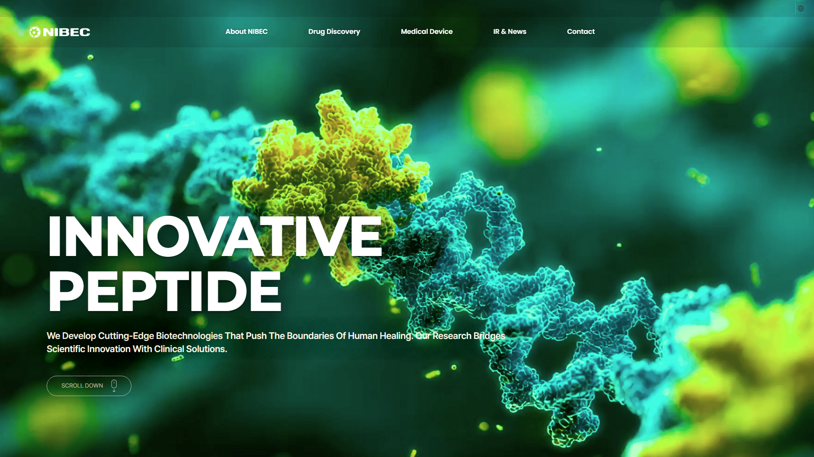
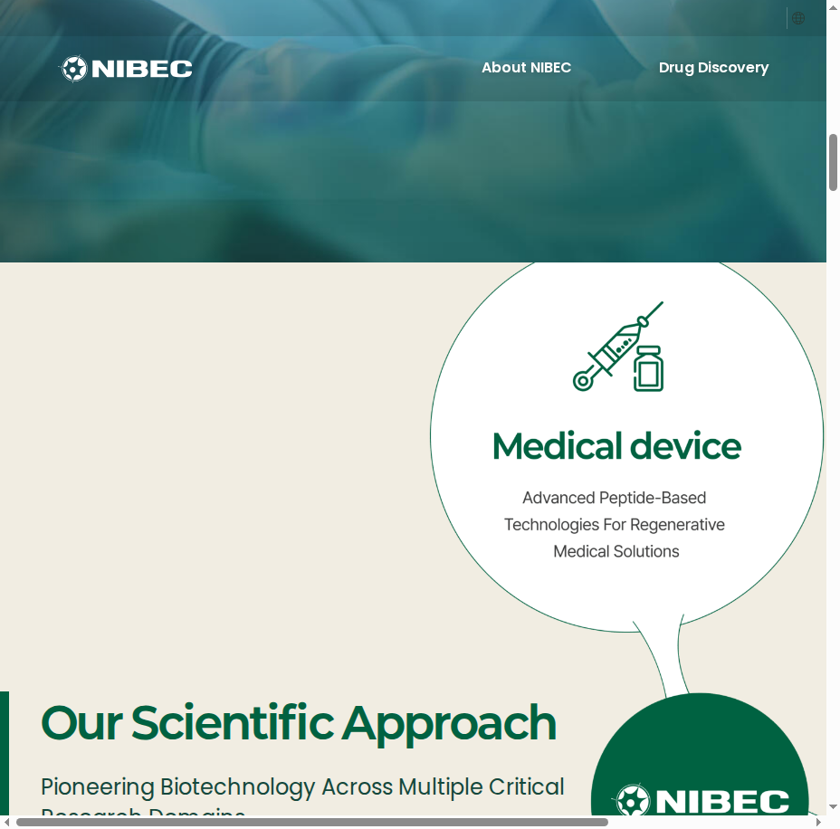
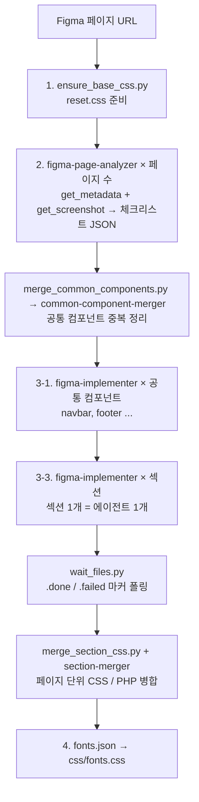

# figma-to-code

기존 Figma MCP 도구를 개선한 Claude Code 하네스


| 문제                       | 원인                                                                                                               |
| ------------------------ | ---------------------------------------------------------------------------------------------------------------- |
| **Sparse 데이터 (가장 큰 문제)** | Figma MCP 도구가 한 번에 내보낼 수 있는 토큰 크기가 작음. 큰 페이지를 통째로 불러오면 디자인 정보가 다 담기지 않은 sparse 데이터만 돌아와서 결과물 품질이 크게 떨어짐          |
| **모델 성능과 컨텍스트 윈도우**      | 프로젝트를 시작한 2025년 12월 당시 모델(Claude Opus 4.5·Sonnet 4.5)은 지금보다 성능이 낮았고 컨텍스트 윈도우도 200K 토큰이라, 페이지 전체를 한 세션에서 다루기 어려웠음 |
| **레이아웃 붕괴**              | 시안이 Auto Layout(Flexbox에 해당) 없이 그려져 있으면 MCP 출력이 절대좌표와 고정 px로 채워짐. 화면 폭이 바뀌거나 폰트 렌더링이 조금만 달라도 요소가 어긋나고 겹침         |
| **계층 구조 노이즈**            | 이미지 밑에 이미지를 여러 장 깔아 둔 구성은 `get_metadata`/`get_design_context`의 계층 정보에 그대로 노이즈로 섞여 들어옴                            |
| **조각난 아이콘**              | 여러 벡터를 조합한 아이콘은 통이미지 한 장으로 받으면 되는데, MCP는 조각을 하나씩 가져옴                                                             |
| **크기 정보 유실**             | `get_design_context`는 `size-full` 같은 상대값을 돌려줘서 실제 픽셀 크기를 알 수 없음                                                  |


---

## 실제 적용 사례: [NIBEC](https://nibec.co.kr/)

이 하네스로 페이지 초안을 빠르게 생성한 뒤 사람이 검수하고 다듬어, **약 2~3일 만에** 사이트를 완성했습니다.

---

## Before / After

### Hero

**Before**


**After**




### Research Domains

**Before**


**After**




---


## 동작 방식



### 핵심 설계

- **섹션 단위 분해**: 페이지를 섹션으로 나누고, 섹션 하나에 `figma-implementer` 하나를 붙입니다. 호출 하나가 섹션 하나 크기로 줄어서 응답이 sparse 데이터로 잘리지 않고, 계층 노이즈와 컨텍스트 사용량도 함께 줄어듭니다.
- **체크리스트가 설계도**: `figma-page-analyzer`가 페이지를 공통 컴포넌트(Navbar, Footer, Sidebar, Modal)와 일회성 섹션으로 분류하고, 각 노드의 `nodeId`, `position`, `size`를 JSON으로 남깁니다. 스키마: [`.claude/docs/checklist-schema.md`](.claude/docs/checklist-schema.md)
- **마커 파일로 상태 관리**: 서브에이전트는 결과를 출력하지 않고 `.claude/markers/`에 `.done`/`.failed` 파일만 남깁니다. 메인 세션은 `TaskOutput` 대신 `wait_files.py`로 파일 개수를 폴링해서 컨텍스트를 아낍니다. 이미 끝난 페이지(`page.completed`)와 공통 컴포넌트(`components.completed`)는 재실행할 때 건너뜁니다.
- **Rate Limit 대응**: 10개 단위 배치로 실행하고 배치 사이에 60초를 둡니다. 429를 받으면 `Retry-After`만큼 기다렸다가 최대 3회 재시도합니다.

---

## 사용법

### 실행

Claude Code에서 아래 명령 중 하나를 실행합니다.

```text
/figma-parallel-part-pipeline {url1} {url2} {url3}
/figma-serial-full-pipeline {url1} {url2} ...
```


| 명령                             | 입력                                         | 섹션 구현 방식                               |
| ------------------------------ | ------------------------------------------ | -------------------------------------- |
| `figma-parallel-part-pipeline` | URL 최대 5개 (3개 권장)                          | 10개씩 배치 병렬. 완료 여부와 관계없이 60초마다 다음 배치 실행 |
| `figma-serial-full-pipeline`   | 전체 페이지 URL (`.claude/figma-urls.json`에 저장) | 섹션 하나씩 순차 실행                           |


### 결과물

```text
{pageName}.php            최종 통합 페이지
css/{pageName}.css        최종 통합 CSS
css/reset.css, fonts.css  공통 스타일
includes/                 공통 컴포넌트 (navbar, footer ...)
assets/images/{pageName}/ 페이지별 이미지
assets/icons/             공용 아이콘
.claude/checklists/       페이지 분석 결과 (보관)
.claude/markers/          작업 이력
```

---

## 저장소 구조

```text
.claude/
├── commands/
│   ├── figma-parallel-part-pipeline.md   병렬 파이프라인
│   └── figma-serial-full-pipeline.md     직렬 파이프라인
├── agents/
│   ├── figma-page-analyzer.md            페이지 → 체크리스트 JSON
│   ├── common-component-merger.md        공통 컴포넌트 중복 정리
│   ├── figma-implementer.md              섹션 1개 → PHP/CSS
│   └── section-merger.md                 섹션 PHP → 페이지 PHP
├── docs/
│   ├── figma-to-css.md                   Figma → CSS 변환 규칙
│   ├── checklist-schema.md               체크리스트 스키마 (v6)
│   └── project-structure.md              폴더·경로·마커 규칙
└── scripts/
    ├── ensure_base_css.py                reset.css 생성
    ├── save_figma_urls.py                URL 목록 저장
    ├── merge_common_components.py        공통 컴포넌트 1차 병합
    ├── get_pending_sections.py           미완료 섹션 조회 (배치 분할)
    ├── wait_files.py                     마커 파일 폴링
    ├── merge_section_css.py              섹션 CSS 병합
    └── utils.py
```

---

## 알려진 한계

- **Figma 파일 구조 품질에 민감함**: Figma 데이터를 기반으로 구현하기 때문에 결과물 품질이 시안의 구조 품질에 크게 좌우됩니다. Auto Layout을 쓰지 않았거나 레이어가 정리되지 않은 시안일수록 결과가 흔들리므로, 생성된 결과물은 **반드시 검수 과정을 거쳐야 합니다.**
- **병렬 파이프라인은 불안정함**: `figma-parallel-part-pipeline`은 Figma MCP 도구 자체의 요청 제한(Rate Limit)에 걸리기 쉬워 실행이 불안정합니다. 요청 한도가 초기화되는 시간을 고려해 섹션을 하나씩 처리하는 **`figma-serial-full-pipeline`을 쓰는 것이 안전합니다.**